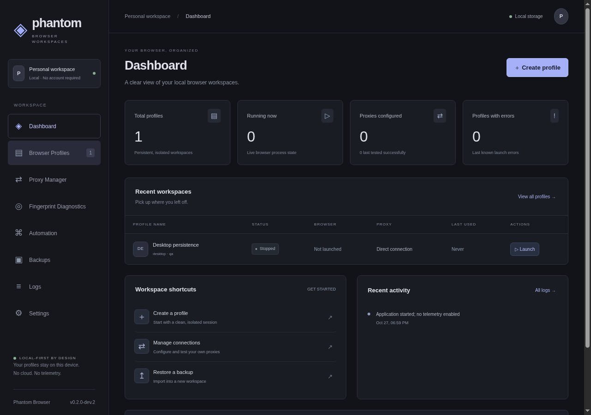
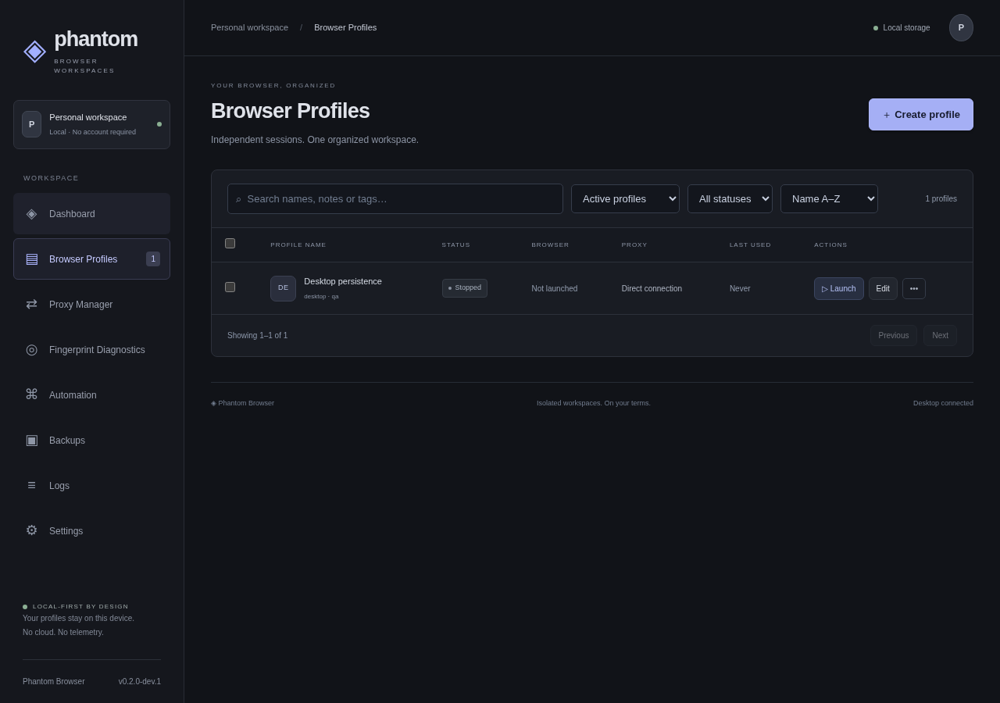

> **Windows installer:** [Download Phantom Browser Setup 0.1.0 (Windows x64)](https://github.com/emmanuellaisa00/phantom-browser/releases/download/v0.1.0/Phantom-Browser-Setup-0.1.0-x64.exe). One setup EXE includes Chromium; no Node.js or Git needed. This unsigned build passed Windows browser, DPAPI, and installed-application smoke tests. [Installation details](docs/WINDOWS_INSTALL.md).

# Phantom Browser — Local-First Windows Profile Manager

> **Status:** v0.1.0 development release. Functional on Linux for development/CI; Windows installer and runtime require a Windows 10/11 host. **Not security-audited. Use at your own risk with test accounts only.**

Phantom Browser is a free, local-first desktop app for managing isolated Chromium browser profiles. Inspired by the workflow of GoLogin, but with **no cloud account, no telemetry, no paid APIs and no stealth/anti-detection claims**.

Each profile owns a **persistent `user-data-dir`** — cookies, localStorage, IndexedDB and cache survive restarts and stay isolated from every other profile.




---

## 1 — Quick start

### Requirements

| Dependency | Version (pinned) | Notes |
|---|---|---|
| Node.js | `>=24.22.0 <25` (see `engines`) | Required for Electron 45 |
| npm | `10.x` | |
| Electron | `45.0.0` | Chromium `156.0.8078.4`, Node `24.22` |
| Playwright | `1.64.1` | Chromium revision `1248` |
| OS | Windows 10/11 x64 for production | Linux/macOS work for dev & CI |

Windows-only runtime features (DPAPI via `safeStorage`, NSIS installer) are **verified on Windows**. Linux CI validates all headless browser, DB and UI tests.

### Install & run

```bash
git clone https://github.com/<you>/phantom-browser.git
cd phantom-browser
npm ci                      # reproducible install from lockfile
npm run provision           # download Playwright Chromium + checksum inventory
npm run build               # typecheck + vite + esbuild bundle
npm start                   # ← production binary, no dev server
# or
npm run dev                 # vite HMR + Electron (PHANTOM_DEV_URL=http://localhost:5173)
```

> **Offline:** check in `browser-runtime/checksums.json` into your internal mirror. `npm run verify:runtime` fails the build if any runtime file is tampered with.

### Scripts

| Command | What it does |
|---|---|
| `npm run dev` | Vite dev server + Electron |
| `npm run build` | `tsc --noEmit` + Vite renderer + `esbuild` main/preload bundle |
| `npm run typecheck` | Strict TS |
| `npm run lint` | ESLint |
| `npm test` | Vitest unit tests |
| `npm run test:integration` | Playwright real-Chromium integration (10 tests) |
| `npm run test:desktop` | Playwright-Electron desktop test (CRUD + offline + IPC) |
| `npm run provision` | Fetches Playwright Chromium to `browser-runtime/` + writes `checksums.json` |
| `npm run verify:runtime` | SHA-256 verify of every runtime file |
| `npm run dist:win` | `electron-builder --win nsis` (requires Windows) |
| `npm run licenses` | Prints third-party license summary |

---

## 2 — Project structure

```
phantom-browser/
├── src/
│   ├── main/          # Electron main: lifecycle, DB, profile/browser/proxy/backup services
│   ├── preload/       # contextBridge typed API (no raw ipcRenderer leak)
│   ├── renderer/      # React 19 + Tailwind 4 UI (8 pages)
│   └── shared/        # Zod schemas — single source of truth for IPC
├── app/               # Build output (gitignored): main/index.cjs, preload/index.cjs, renderer/
├── browser-runtime/   # Playwright Chromium (gitignored, provisioned, checksum-verified)
├── tests/             # Vitest unit + Playwright integration + Electron desktop
├── scripts/           # bundle.mjs, dev.mjs, provision.mjs, verify-runtime.mjs
├── docs/              # Screenshots
├── package.json       # Pinned deps + electron-builder config
├── vite.config.ts / tsconfig.json / eslint.config.mjs
└── .github/workflows/ci.yml
```

---

## 3 — Architecture

### Electron processes

* **Main** — `src/main/index.ts` + `service.ts` + `database.ts` + `ipc.ts`. Owns SQLite (`sql.js`), profile directories, process supervisor, DPAPI, backup/restore, logs.
* **Preload** — `src/preload/index.ts` exposes **one frozen object** `window.phantom.request(req)` validated by Zod. No filesystem, `child_process`, or `ipcRenderer` leakage.
* **Renderer** — `src/renderer/main.tsx` React app. All data comes from `snapshot()` (profiles, proxies, logs, backups, diagnostics, jobs, settings, engine string). No fake metrics.

### Security hardening

* `contextIsolation: true`, `nodeIntegration: false`, `sandbox: true`, `webSecurity: true`
* Strict CSP: `default-src 'self'; script-src 'self'; style-src 'self' 'unsafe-inline'…`
* `setWindowOpenHandler → deny`, `will-navigate` allow-listed to single trusted URL, permission handler denies all
* `authorized()` checks **senderId + top-frame URL + isTop** on every IPC call
* Zod strict schemas reject unknown fields, path traversal, `file://` URLs, oversized payloads
* Logs and diagnostics never include proxy credentials

### Database

`sql.js` (WASM SQLite) stored at `app.getPath('userData')/phantom.sqlite` — **not** beside the executable. Migrations via `PRAGMA user_version`. Tables: `profiles`, `proxies`, `settings`, `profile_tags`, `launches`, `diagnostics`, `backups`. Prepared statements + transactions + FK indexes.

---

## 4 — Features (implemented)

#### Profile CRUD & lifecycle
* Create/edit/duplicate/delete (explicit confirmation dialog), search/filter/sort/paginate, bulk stop/delete, open storage (safe `shell.openPath`), status badges (`stopped/starting/running/error`), engine version, last-used.
* One persistent `user-data-dir` per profile. Concurrency guard via `.phantom-lock` (PID + ESRCH stale recovery). `acquire`/`release` reliably, crash recovery via `BrowserContext close` listener + `launches` interrupted marker.
* Duplication deep-copies data dir (excluding lock files/symlinks) and mints a new UUID.

#### Browser engine
* `chromium.launchPersistentContext(userDataDir, { proxy, viewport, screen, locale, timezoneId, colorScheme, reducedMotion, userAgent, geolocation })` — real Chromium 156 process per profile, multiple concurrent (default cap 3, configurable to 20 with warning).
* `chromiumSandbox: !headless` so production keeps Chrome sandbox.
* PID capture via `SystemInfo.getProcessInfo` CDP; `close` event drives state + log.

#### Browser configuration & diagnostics
* Typed, versioned `configSchema` (`version:1`). Supported: userAgent, viewport, screen, locale, timezone, colorScheme, reducedMotion, geolocation (opt-in). Validates locale/timezone via `Intl`, rejects inconsistent `screen < viewport`, unknown keys. No silent fallback — shows validation errors.
* Diagnostics page runs `page.evaluate` in the **active tab** and compares `expected vs observed` (UA, language, timezone, viewport, screen, colorScheme, reducedMotion) + reports `hardwareConcurrency`, `platform`, WebGL vendor/renderer, `webdriver`. No undetectability claims.

#### Proxy manager
* HTTP/HTTPS/SOCKS5 (Chromium-validated; SOCKS5 auth rejected). Add/edit/delete/assign/test. Test spawns a **temporary** headless Chromium with that proxy and fetches `https://api.ipify.org?format=json` — result is `"Connected — public IP x"` or redacted failure. Never “saved = working”.
* Credentials stored as `BLOB` encrypted via **Windows DPAPI `safeStorage.encryptStringAsync`**; `hasCredentials` flag only in `proxies.data` JSON. On Linux/macOS, `seal/open` throws — **fails closed, no plaintext fallback**. Snapshots never contain secrets. Backup manifest forces `proxyId: null`.

#### SQLite persistence
* Survives restart (dashboard counts, tags, settings proven in tests). `profile_tags` indexed, `launches` history, `backups`/`diagnostics` retention.

#### Backup & restore
* Stop profile → walk `userDataDir` (skip `.phantom-lock/Cache/GPUCache`, reject symlinks, 256 MiB cap) → hash each file SHA-256 → `gzip({format:'phantom-backup', version:1, engine, profile, files:[{name,size,sha256,base64}]})` → atomic `.partial` rename + checksum-indexed row.
* Restore validates gzip, Zod manifest, Windows-reserved names, control chars, duplicate case-insensitive paths, per-file size/hash, total cap, 400 MiB archive limit, then creates **new profile** + writes files `0600`. Never overwrites existing. Proxy excluded, note about OS-bound cookie encryption.

#### Automation
* Playwright-powered local runner: `navigate(url)`, `title()`, `screenshot()`, `wait(selector)`, `click(selector)`, `fill(selector,value)`. Explicit user start, loopback only, no remote port. Job cancel = `context.close()` → profile lock released. Reports + PNG screenshots in `userData/reports/` (`0600`).

#### UI
* Premium dark graphite theme (compact tables, subtle borders, restrained accent). 8 pages: Dashboard, Profiles, Proxies, Diagnostics, Automation, Backups, Logs, Settings. Loading/empty/error/success/confirm states; keyboard nav + focus-visible; no fake analytics.

---

## 5 — Not implemented / out of scope

* macOS/Linux DPAPI equivalent (Keychain/libsecret) — secrets fail closed on non-Windows (by design per spec’s “Windows DPAPI through a maintained implementation”).
* Authenticated SOCKS5 (unsupported by Chromium engine — validated rejection).
* WebRTC/DNS leak toggles beyond what Playwright/Chromium exposes.
* Encrypted backups with user passphrase (spec allows optional; not shipped — archives are **not encrypted**, clearly warned).
* Auto-update, telemetry, cloud sync, CAPTCHA solving, stealth “undetectable” spoofing — intentionally omitted.
* Canvas/WebGL string override beyond diagnostic reporting (brittle JS spoofing avoided).

---

## 6 — Test results (Linux CI, Chromium 156 headless)

```
Vitest unit:              18 passed
  - CRUD + counts + UUID isolation
  - DB persistence + tags + settings across restart
  - Duplicate independence
  - Delete confirmation + rollback guard
  - Interrupted launch recovery
  - Zod validation (timezone, strict fields, screen/viewport, file:// rejection)
  - IPC auth (senderId + top-frame URL)
  - Offline snapshot
  - Credential-at-rest not in plaintext/snapshot
  - DPAPI fail-closed & retain/clear semantics
  - Backup/restore + traversal + checksum + Windows names

Playwright integration:    10 passed (controlled localhost HTTP server)
  - Launch → cookie/localStorage → close → relaunch persistence
  - Two profiles isolated cookies/storage
  - Duplicate session independence
  - Simultaneous launch lock + edit/delete guards
  - Stale vs live .phantom-lock PIDs
  - Observed prefs (viewport/screen/locale/timezone/colorScheme) + webdriver diagnostic
  - Automation navigate/wait/fill/click/title/screenshot + report files
  - Automation stop via profile close
  - Backup while running rejected; stop→backup→restore preserves session
  - Crash (browser.close()) cleans state + lock, records launch outcome
  - Failed launch cleans state, no credential leak

Playwright Electron:        1 passed, 1 skipped (DPAPI needs Windows)
  - Secure preload (require undefined), strict IPC rejects exec, CRUD → restart → offline persistence, screenshots
```

Run yourself:

```bash
npm run typecheck && npm run lint && npm test
npm run test:integration
xvfb-run -a npm run test:desktop   # needs xvfb on Linux
```

---

## 7 — Windows installer

### Provisioning strategy (reproducible, verifiable)

1. **Source:** Playwright’s pinned Chromium (`cdn.playwright.dev/builds/cft/<version>` over HTTPS). Revision is locked in `package.json` (`playwright@1.64.1` → Chromium `156.0.8078.4`, `ffmpeg@1013`).
2. **Download:** `npm run provision` → `PLAYWRIGHT_BROWSERS_PATH=browser-runtime npx playwright install chromium` (verifies CDN TLS, Playwright verifies `Content-Length`).
3. **Inventory:** script SHA-256 hashes every file in `browser-runtime/` into `checksums.json` (`playwright`, `platform`, `files[]`).
4. **Verification:** `npm run verify:runtime` re-hashes and compares — build fails on mismatch. Commit `checksums.json` to your release branch and pin it.
5. **Offline:** vendor `browser-runtime/` tarball internally; extract before `npm run dist:win`.
6. **Update:** bump `playwright` → bump `electron` to match Chromium major → `npm run provision` → review new `checksums.json` diff → QA integration tests → tag.

> We also mirrored upstream Chromium snapshots (`storage.googleapis.com/chromium-browser-snapshots`) during development to cross-check version availability — not used for release builds.

### Build

```powershell
# On Windows 10/11 x64, Node 24.x
npm ci
npm run provision
npm run verify:runtime
npm run build
npm run dist:win   # electron-builder --win nsis
# Output: release/Phantom Browser Setup 0.1.0.exe
```

`electron-builder` config in `package.json`:

* `appId: org.phantombrowser.desktop`, `asar: true`, `files: [app/**]`, `extraResources: [{from: browser-runtime, to: browser-runtime}]`
* `win.target: nsis x64`, `oneClick: false`, `deleteAppDataOnUninstall: false`
* Main entry `app/main/bootstrap.cjs` sets `PLAYWRIGHT_BROWSERS_PATH` to `process.resourcesPath/browser-runtime` when packaged; `dist:win` runs `npm run build` first so `app/` is fresh.

**Linux cross-build note:** NSIS without Wine produces a stub; use a Windows runner (`windows-latest` GitHub Action) for signed installers. The repo’s `ci.yml` runs typecheck/lint/unit/integration on `ubuntu-latest` and the NSIS job on `windows-latest`.

### Smoke test (after install)

1. Launch app → Dashboard shows `Desktop connected`, engine `Playwright Chromium chromium-1248/...`
2. Create profile → Launch → `https://example.com` → set cookie → close → relaunch → cookie present
3. Launch two profiles → `localStorage` isolation check on diagnostics page
4. Backup stopped profile → restore → new profile contains session
5. `userData` lives in `%APPDATA%/Phantom Browser/` — uninstall leaves it intact

---

## 8 — Security considerations

* **Secrets:** DPAPI only, async API, `isAsyncEncryptionAvailable()` gate. Fail-closed on Linux/macOS (no silent AES fallback that pretends to be DPAPI). Proxies’ `secret BLOB` never logged, never in renderer, never in backup. Tests assert bytes not in SQLite file.
* **Backups:** Session data = authentication material. Backups are **gzip only, not encrypted** — warned on every export. Restores warn about OS-bound `Local State` key (cookies may be undecryptable on a different Windows account/machine).
* **Proxy:** Docs call out protocol limits (no SOCKS5 auth), DNS/WebRTC “engine-default” behavior, IP leak risk if app is closed incorrectly.
* **IPC:** `authorized` + strict Zod + explicit host actions (`confirmDelete`, `saveBackup`, …) — no generic file or shell access.
* **Logs:** `application.log` (rotated at 2 MiB) contains lifecycle events, never secrets; also shown in Logs viewer.

---

## 9 — Known limitations & Chromium notes

* **Chromium vs Chrome for Testing:** Playwright’s browser is `Chrome for Testing 156.0.8078.4` (`chrome-linux64/chrome`). It behaves like Chromium for profile isolation but carries Chrome’s `WidevineCdm`. Redistribution is under Chromium/BSD + Google’s CfT terms — see `scripts/licenses.mjs` output.
* **Client hints vs UA override:** `userAgent` is passed to `launchPersistentContext`; modern sites may still see mismatched Client Hints. Diagnostics flags UA mismatch rather than hiding it.
* **Screen/viewport:** Playwright forwards `screen` to `window.screen`; some headful environments clamp it. Test asserts `1000×700` viewport inside `1400×900` screen on Linux headless — may vary on HiDPI Windows.
* **Geolocation:** `geolocation` field is forwarded as `context.geolocation`; permissions default **denied** unless geolocation is set — app requests none otherwise.
* **Headless fingerprint:** `navigator.webdriver === true` is visible (reported, not spoofed). Use headful launch if your test harness needs `webdriver: false` (requires a display; not implemented as a spoof).
* **Memory:** Each profile = separate Chromium process tree (~180–350 MiB idle). The “max 20” cap is user-configurable, not a guarantee — monitor Task Manager.
* **Offline:** App starts with no network (proven in tests). Proxy test intentionally fails when offline — shown as redacted error, not silent success.

---

## 10 — Third-party licenses

Run `npm run licenses` (or `npm run provision -- --licenses` if you vendor). Summary:

| Package | License | Notes |
|---|---|---|
| Electron 45 | MIT | Bundles Chromium 156 — BSD-3-Clause |
| Playwright 1.64.1 | Apache-2.0 | Chromium builds fetched from `cdn.playwright.dev` under BSD |
| Chromium 156 | BSD-3-Clause | + Widevine CDM (Google proprietary, redistributable with CfT) |
| React 19 / React-DOM | MIT | |
| sql.js 1.15.2 (SQLite) | MIT | SQLite itself public domain |
| yauzl 3.4.0 | MIT | Used only for optional snapshot inspection |
| zod 4.6.7 | MIT | |
| Tailwind CSS 4 / Vite 8 / Vitest | MIT | Dev |
| esbuild 0.28.2 | MIT | |

Full text: `node_modules/<pkg>/LICENSE*` and `browser-runtime/*/LICENSE`. Chromium redistribution must respect `chrome-linux64/LICENSE` and not imply Google endorsement — see [chromium.org/chromium-os/developer-library](https://www.chromium.org/chromium-os/developer-library).

---

## 11 — Troubleshooting

| Symptom | Fix |
|---|---|
| `Credential storage requires Windows DPAPI` | Normal on Linux/macOS — proxy passwords cannot be saved there. Use Windows host for credential tests. |
| `Browser launch failed` | Check `profile.lastError`, antivirus blocking `chrome-headless-shell`, or corrupted `userDataDir` (restore backup). |
| `Backup exceeds 256 MiB` | Clear browser caches (`Settings → clear on next launch` not yet implemented — close profile, delete `Cache/Code Cache` manually), then retry. |
| `Unsafe or duplicate archive path` on restore | Re-download backup; source may have been tampered with (checksum mismatch). |
| `Profile is locked by a live process` | Kill stale Electron/Chrome from Task Manager; app auto-recovers from `ESRCH` PID on next launch. |
| Installer warns “Unknown publisher” | Expected for self-signed dev build — sign with EV cert in release pipeline. |
| `npm ci` engine error `need Node >=22.12` | `nvm install 24 && nvm use 24` |

---

## 12 — Contributing & repo hygiene

* Strict TS, `noUncheckedIndexedAccess`, ESLint `no-explicit-any: error`
* Conventional commits, PR must pass `ci.yml` (typecheck + lint + unit + integration)
* Do **not** commit `browser-runtime/`, `release/`, `app/`, `test-results/`, `.tmp` files, or secrets
* PATs, if used to push, must be via `GH_TOKEN` env var with `repo` scope, rotated after CI — never paste into chat

---

## 13 — Credits

Built with Electron, Playwright, React, Tailwind, `sql.js`, Zod. Thanks to upstream Chromium/Playwright teams.

**Phantom Browser v0.1.0 — isolated workspaces. On your terms.**
