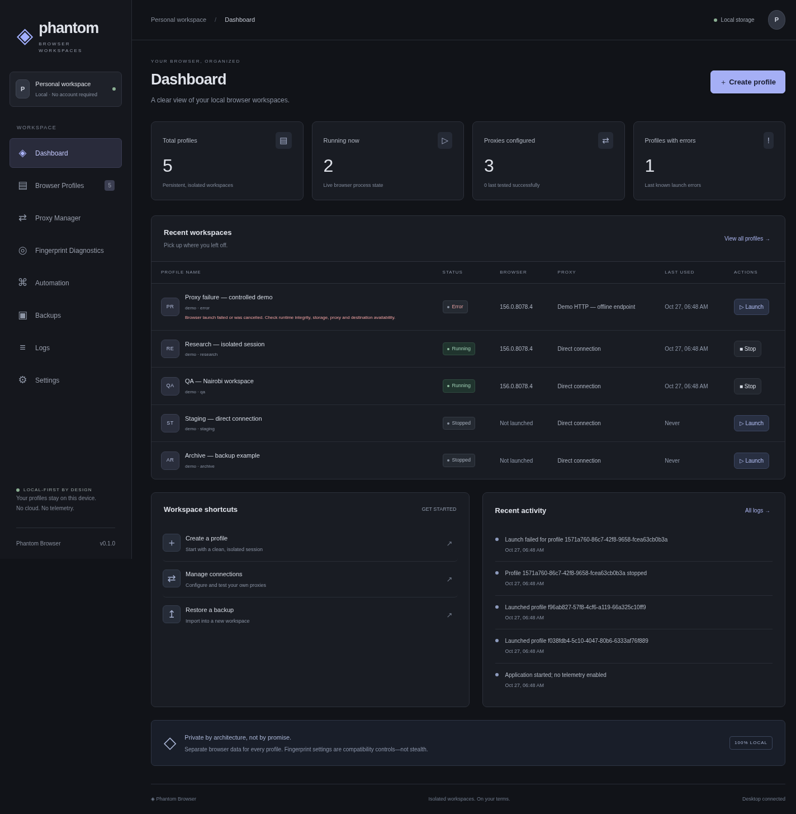
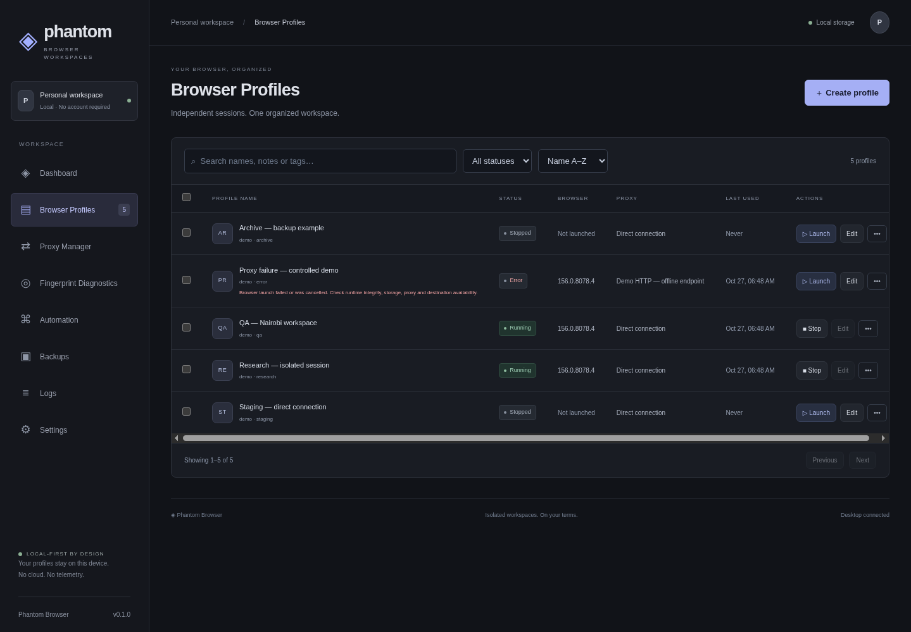
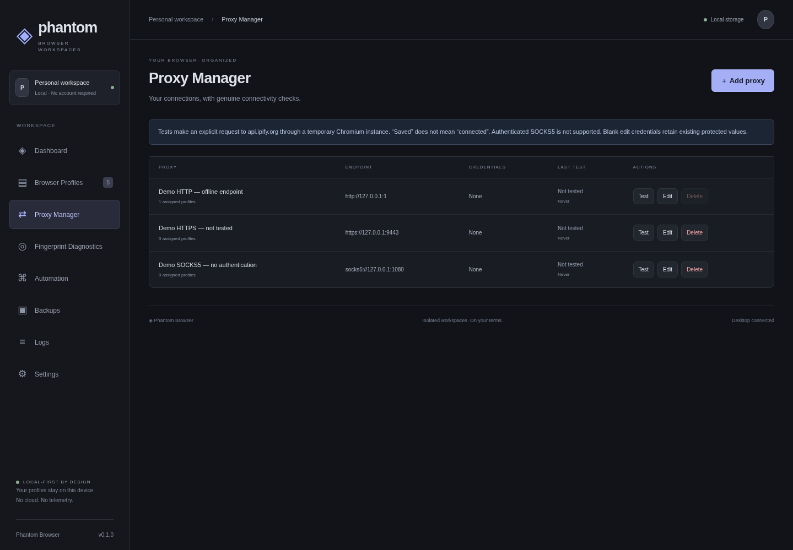
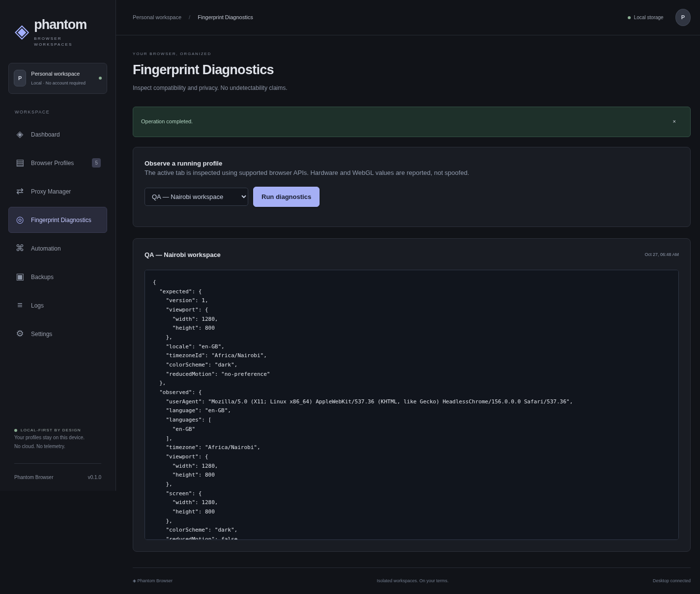
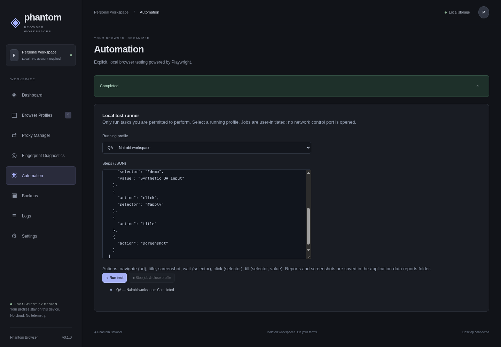
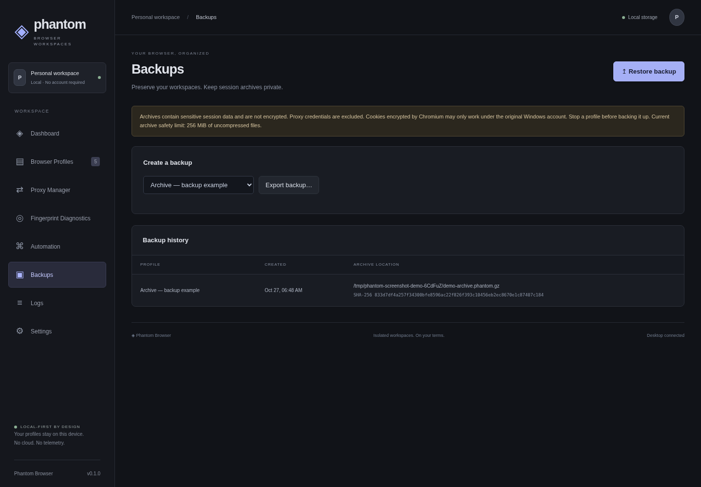
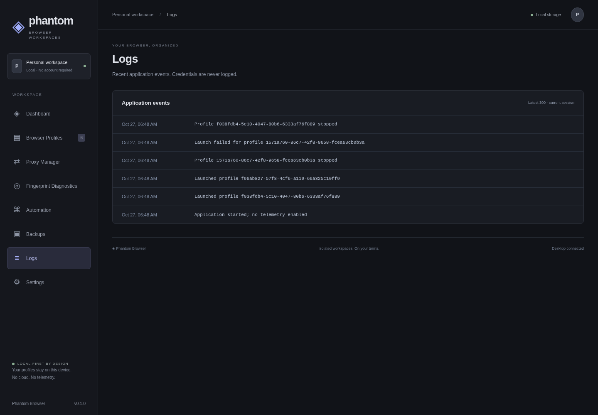
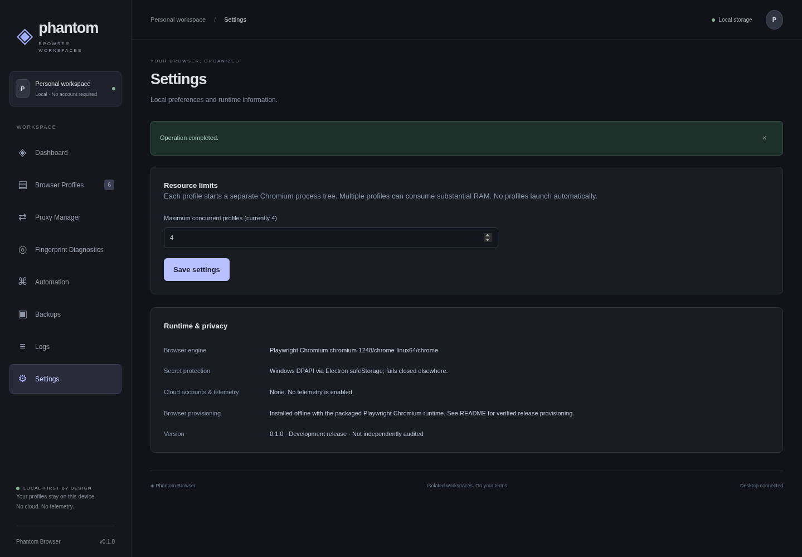

# Phantom Browser — screenshot gallery

**40 real captures** of the Electron app, source commit `d44c42735dfdf72f4f78ea9b5e1fcb82be9d4af2`. Capture date: 2026-10-27T06:48:35.471Z.

All data is synthetic and stored in a disposable fixture. The capture driver uses real IPC, SQLite, Chromium profiles, diagnostics, automation and backup/restore; it does not fabricate counts, connectivity or job statuses. No real account, cookie, proxy credential, private profile, archive or database is committed. Temporary fixture data is deleted at the end.

**Platform:** Linux x64, Electron, 1440×1000 window; some renderer screenshots extend to full page height. The four native GTK dialogs are Linux examples, **not Windows screenshots**. Chromium runs headless with its sandbox disabled only in the Linux documentation harness; production application code is unchanged. Native file pickers are opened with the same backup options against the disposable fixture; seed backup/restore dialog responses are automated.

**Existing UI issue:** the v0.1.1 source still hardcodes a v0.1.0 label in the sidebar/Settings. These captures are unretouched and preserve that label; no app-version fix is bundled into this documentation-only change.

## Main populated pages

### Dashboard — populated and live



### Profiles — running, stopped and controlled failure



### Proxy manager — configured, not falsely connected



### Diagnostics — actual Chromium observations



### Automation — genuine completed job



### Backups — real archive and SHA-256 history



### Logs — genuine demo-session events



### Settings — resource limit saved



## Complete inventory

| # | Capture | Type | Dimensions |
|---|---|---|---|
| 1 | [Dashboard — fresh workspace](01-01-fresh-dashboard.png) | Electron renderer | 1424×1246 |
| 2 | [Browser Profiles — fresh workspace](01-02-fresh-browser-profiles.png) | Electron renderer | 1439×999 |
| 3 | [Proxy Manager — fresh workspace](01-03-fresh-proxy-manager.png) | Electron renderer | 1439×999 |
| 4 | [Fingerprint Diagnostics — fresh workspace](01-04-fresh-fingerprint-diagnostics.png) | Electron renderer | 1439×999 |
| 5 | [Automation — fresh workspace](01-05-fresh-automation.png) | Electron renderer | 1439×999 |
| 6 | [Backups — fresh workspace](01-06-fresh-backups.png) | Electron renderer | 1439×999 |
| 7 | [Logs — fresh workspace](01-07-fresh-logs.png) | Electron renderer | 1439×999 |
| 8 | [Settings — fresh workspace](01-08-fresh-settings.png) | Electron renderer | 1439×999 |
| 9 | [Create profile dialog](02-01-create-profile.png) | Electron renderer | 1439×999 |
| 10 | [Create profile — filled demo configuration](02-02-create-profile-filled.png) | Electron renderer | 1439×999 |
| 11 | [Create profile — configuration and validation guidance](02-03-create-profile-config.png) | Electron renderer | 1439×999 |
| 12 | [Profile configuration validation error](02-04-profile-validation.png) | Electron renderer | 1439×999 |
| 13 | [Add proxy dialog](03-01-add-proxy.png) | Electron renderer | 1439×999 |
| 14 | [Add proxy — synthetic loopback endpoint](03-02-add-proxy-filled.png) | Electron renderer | 1439×999 |
| 15 | [SOCKS5 configuration — authentication disabled](03-03-socks5-dialog.png) | Electron renderer | 1439×999 |
| 16 | [Dashboard — populated and live](04-01-dashboard-populated.png) | Electron renderer | 1424×1455 |
| 17 | [Profiles — running, stopped and controlled failure](04-02-profiles-populated.png) | Electron renderer | 1439×999 |
| 18 | [Profiles — bulk selection](04-03-profiles-bulk-selection.png) | Electron renderer | 1439×999 |
| 19 | [Profiles — running filter](04-04-profiles-running-filter.png) | Electron renderer | 1439×999 |
| 20 | [Profiles — no matching search results](04-05-profiles-no-search-results.png) | Electron renderer | 1439×999 |
| 21 | [Edit existing profile](04-06-edit-profile.png) | Electron renderer | 1439×999 |
| 22 | [Profile actions menu](04-07-profile-actions-menu.png) | Electron renderer | 1439×999 |
| 23 | [Proxy manager — configured, not falsely connected](05-01-proxy-manager-populated.png) | Electron renderer | 1439×999 |
| 24 | [Edit proxy — credential handling guidance](05-02-edit-proxy.png) | Electron renderer | 1439×999 |
| 25 | [Proxy connectivity test — genuine failure](05-03-proxy-test-failure.png) | Electron renderer | 1439×999 |
| 26 | [Diagnostics — actual Chromium observations](06-01-diagnostics-result.png) | Electron renderer | 1424×1209 |
| 27 | [Automation — six-action local test](07-01-automation-ready.png) | Electron renderer | 1439×999 |
| 28 | [Automation — genuine completed job](07-02-automation-completed.png) | Electron renderer | 1439×999 |
| 29 | [Automation — invalid JSON rejected](07-03-automation-validation.png) | Electron renderer | 1424×1065 |
| 30 | [Automation — running cancellable wait](07-04-automation-running.png) | Electron renderer | 1439×999 |
| 31 | [Automation — cancelled job and closed profile](07-05-automation-cancelled.png) | Electron renderer | 1439×999 |
| 32 | [Backups — real archive and SHA-256 history](08-01-backup-history.png) | Electron renderer | 1439×999 |
| 33 | [Backups — completed restore retained in history](08-02-backup-restored.png) | Electron renderer | 1439×999 |
| 34 | [Profiles — restored copy has a new identity](08-03-restored-profile.png) | Electron renderer | 1439×999 |
| 35 | [Logs — genuine demo-session events](09-01-logs-populated.png) | Electron renderer | 1439×999 |
| 36 | [Settings — resource limit saved](10-01-settings-saved.png) | Electron renderer | 1439×999 |
| 37 | [Native backup sensitivity warning](11-01-native-backup-warning.png) | Linux native desktop dialog | 1440×1000 |
| 38 | [Native permanent-delete confirmation](11-02-native-delete-confirmation.png) | Linux native desktop dialog | 1440×1000 |
| 39 | [Native restore archive picker](11-03-native-restore-file-picker.png) | Linux native desktop dialog | 1440×1000 |
| 40 | [Native backup export picker](11-04-native-export-file-picker.png) | Linux native desktop dialog | 1440×1000 |

## Reproduce

Install the pinned Node dependencies, provision Chromium and build the app. On Linux, install Xvfb, ImageMagick (`import` command), xdotool and Electron/Chromium system dependencies. Then:

```bash
npm run build
xvfb-run -a -s '-screen 0 1440x1000x24' node scripts/capture-screenshots.mjs
node scripts/build-screenshot-gallery.mjs
```

The capture driver exits nonzero if a required state cannot be reached. The gallery builder validates PNG headers and the inventory, and records dimensions/SHA256 for each file in [manifest.json](manifest.json). Screenshots are documentation, not a substitute for the project's automated tests or Windows install checks.
